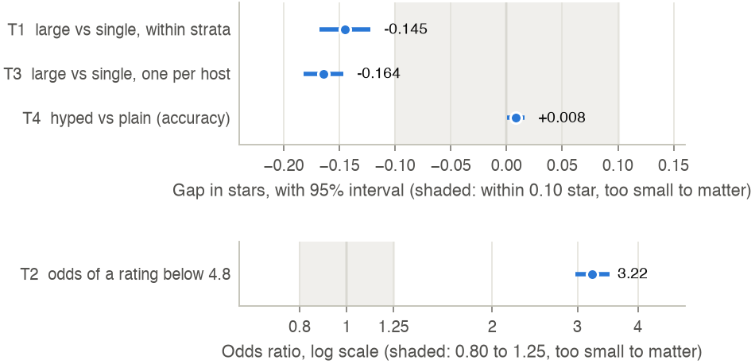
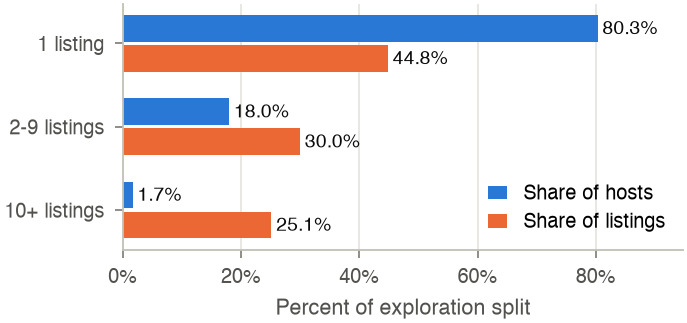
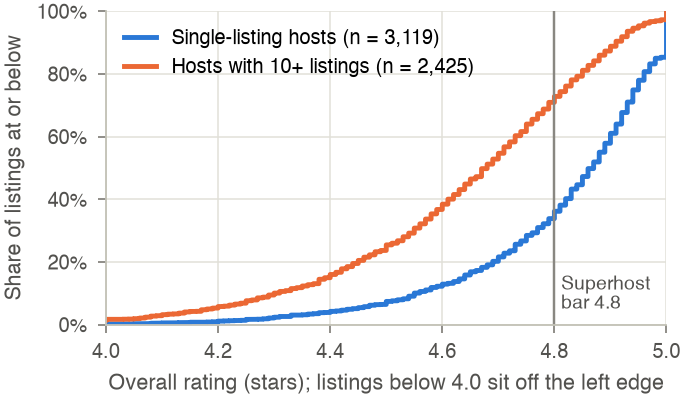
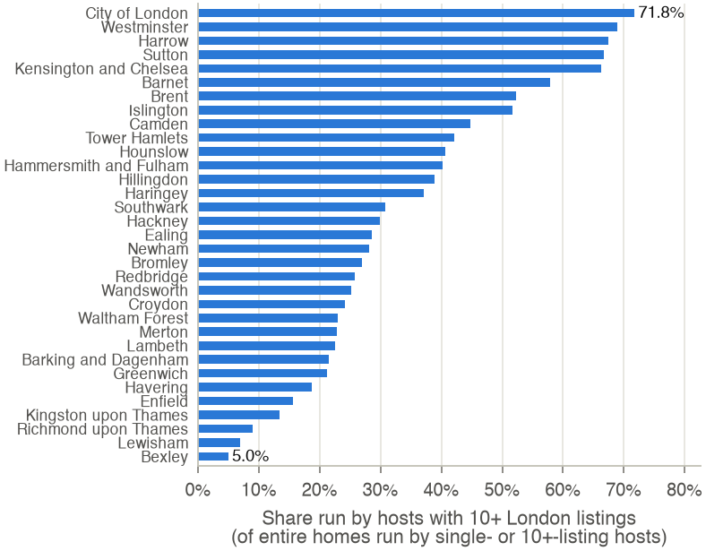
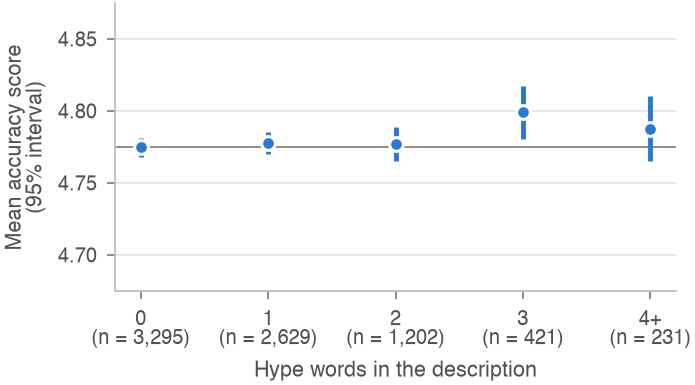
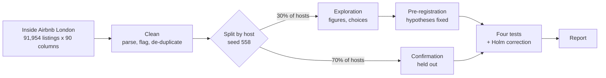

<div align="center">

# Do multi-listing hosts drag ratings down?

**Evidence from 91,954 London Airbnb listings**

CSE558 Data Science &middot; Monsoon 2026 &middot; IIIT-Delhi &middot; Midterm project (statistical inference)


</div>

One in four London Airbnb listings is run by a host with ten or more properties. Do guests rate
those listings differently from homes run by someone with a single listing? And does a
description stuffed with words like *stunning* and *luxury* come back to bite a listing when
guests judge whether it matched its page? We answer both questions with pre-registered
hypothesis tests on the Inside Airbnb London snapshot of 17 September 2026.

## Contents

- [Key results](#key-results)
- [What the data looks like](#what-the-data-looks-like)
- [How we did it](#how-we-did-it)
- [Dataset](#dataset)
- [Reproduce the results](#reproduce-the-results)
- [Repository structure](#repository-structure)
- [Team](#team)

## Key results

- **Large hosts rate lower, by a margin that matters.** Within the same borough and bedroom
  count, a home run by a host with 10+ London listings scores **0.145 star lower** than one run
  by a single-listing host (95% CI 0.122 to 0.168 lower). We had set 0.10 star as the smallest
  gap worth caring about before running any test.
- **They miss the Superhost bar far more often.** 65.5% of large-host homes fall below Airbnb's
  4.8 rating bar, against 34.6% of single-host homes: **3.2 times the odds** after holding borough
  and size fixed.
- **The finding survives three different designs.** Comparing listings within strata,
  clustering standard errors by host, and counting every host only once all give a gap of 0.15
  to 0.16 star.
- **Hype in descriptions does not matter.** Listings with two or more superlatives score
  **+0.008 star** on accuracy. The difference is statistically detectable, but about a tenth of
  what a guest could notice.

<p align="center">
  
  <br>
  <sub>Each dot is an estimate with its 95% interval. Shaded bands mark differences we decided in advance were too small to matter.</sub>
</p>

| Test | Question | Method | Estimate (95% CI) | Holm-adjusted p | Verdict |
|:---:|---|---|---|---|---|
| T1 | P1 | within-stratum gap, host-clustered standard errors | -0.145 star (-0.168, -0.122) | 2.3e-34 | reject H0, matters |
| T2 | P1 | Cochran-Mantel-Haenszel, share below 4.8 | odds ratio 3.22 (2.97, 3.49) | 1.1e-183 | reject H0, matters |
| T3 | P1 | Welch t-test on host-level means | -0.164 star (-0.182, -0.146) | 1.0e-55 | reject H0, matters |
| T4 | P2 | stratified permutation test | +0.008 star (+0.0004, +0.016) | 0.044 | reject H0, too small to matter |

The full write-up, with every test's hypotheses, alternatives and limitations, is
[`report/report.pdf`](report/report.pdf).

## What the data looks like

All four figures come from the exploration split only. The tests above used the other 70% of
hosts, which we did not look at until the hypotheses were fixed.

<table>
  <tr>
    <td width="50%" valign="top">
      
      <br><sub><b>Few hosts, many listings.</b> Hosts with 10+ London listings are 1.7% of hosts but run 25.1% of listings.</sub>
    </td>
    <td width="50%" valign="top">
      
      <br><sub><b>A visible gap.</b> 70.9% of large-host homes sit below the 4.8 Superhost bar, against 33.8% of single-host homes.</sub>
    </td>
  </tr>
  <tr>
    <td width="50%" valign="top">
      
      <br><sub><b>Location confounds it.</b> Large hosts run 5% of homes in Bexley but 72% in the City of London, so every comparison holds borough fixed.</sub>
    </td>
    <td width="50%" valign="top">
      
      <br><sub><b>Hype barely moves accuracy.</b> Mean accuracy stays within 0.025 star of the no-hype level at every count.</sub>
    </td>
  </tr>
</table>

## How we did it



### Data preparation

The raw file needed real work. Every step, and the reason for it, is logged in
[`outputs/tables/prep_log.csv`](outputs/tables/prep_log.csv).

- **Prices** were stored as text with a `$`, even though Airbnb's own quotes give the currency as
  GBP. We parsed them to numbers.
- **35% of prices were missing**, but not at random: 87% of those listings had no availability
  at all, so we flagged them instead of inventing prices.
- **179 units were listed twice.** 95 of the copies belonged to large hosts, the very group we
  study, so leaving them in would have counted those hosts twice.
- **15 columns were completely empty**, bathrooms existed only as free text in 47 forms, and 7
  listings had impossible rating averages below 1 star.
- After encoding, the table is **91,775 x 219 = 20.1 million cells**, well above the course's 3
  million floor. The full data dictionary is in [`docs/data_dictionary.md`](docs/data_dictionary.md).

### The tests, and why these ones

| Test | Why this test | Also compared |
|---|---|---|
| T1 | A large operator's listings are not independent, so standard errors are clustered by host, and comparisons stay inside borough-by-bedroom strata | Welch and pooled t, Mann-Whitney, stratified permutation |
| T2 | A yes/no outcome compared across 96 strata | pooled chi-square, two-proportion z, Fisher, Breslow-Day check |
| T3 | Counting each host once removes dependence by design rather than by a model | pooled t, Mann-Whitney, permutation |
| T4 | Accuracy scores are bounded and bunched near 5, so a permutation test avoids assuming normality | Welch t, Mann-Whitney, Spearman dose-response |

> [!NOTE]
> Hypotheses, significance level, sidedness, test choice and the smallest difference that
> matters were all written to [`docs/preregistration.json`](docs/preregistration.json) before any
> test touched the confirmation data. The notebook prints that file's SHA-256 before testing, and
> a Holm correction controls the error rate across all four tests.

## Dataset

| | |
|---|---|
| Source | [Inside Airbnb](https://insideairbnb.com/get-the-data/), London, England, United Kingdom |
| Snapshot | compiled 17 September 2026 |
| File | [`listings.csv.gz`](https://data.insideairbnb.com/united-kingdom/england/london/2026-09-17/data/listings.csv.gz) (detailed listings, 48 MB) |
| Size | 91,954 listings x 90 columns |
| SHA-256 | `8017870734a9bffa1b424937372e5f02f8c4a114e5060534d7423be5fd718b4c` |
| Licence | CC BY 4.0 |

The raw file is not committed. The notebook downloads it and checks the SHA-256 above. Inside
Airbnb keeps about a year of snapshots online, after which this one can be requested from their
archive. Links to every dataset we compared before choosing this one are in
[`docs/dataset_links.pdf`](docs/dataset_links.pdf).

## Reproduce the results

You need Python 3.13 (we used 3.13.15 on macOS), an internet connection for the 48 MB download,
and about a minute.

```bash
git clone https://github.com/Nishant7p/DataSci-Project.git
cd DataSci-Project
python3 -m venv .venv
source .venv/bin/activate            # Windows: .venv\Scripts\activate
pip install -r requirements.txt

# run the full analysis from a clean kernel
jupyter nbconvert --to notebook --execute --inplace notebooks/midterm_analysis.ipynb

# unit tests, plus checks that every key number in the report matches the outputs
python -m pytest -q
```

Every random step uses seed **558**, so a re-run reproduces every table byte for byte. To rebuild
the report, run `tectonic report/report.tex`, or upload the `report/` folder to Overleaf and
compile with pdfLaTeX.

## Repository structure

```
notebooks/midterm_analysis.ipynb   the full analysis, executed, with outputs
src/
  prep.py                          download, checksum, cleaning, split, encoding
  stats_tests.py                   clustered fixed-effects t, Cochran-Mantel-Haenszel,
                                   stratified permutation and bootstrap, Welch, Holm
  dictionary.py                    data dictionary specification
  figures.py                       all figures
tests/                             unit tests and report-consistency checks (pytest)
docs/                              data dictionary, pre-registration, requirement
                                   checklist, dataset links
outputs/
  tables/                          every number used in the report (JSON, CSV)
  figures/                         Figures 1 to 5 (PDF and PNG)
report/                            report.tex, report.pdf and the figures it uses;
                                   template_original.tex is the untouched course template
```

## Team

| Name | Roll no. |
|---|---|
| Nischay Soni | 2023353 |
| Nishant Tomer | 2023355 |
| Sarthak | 2023490 |
| Syed Musa Kazim | 2023543 |
| Yash | 2023605 |

Data from [Inside Airbnb](https://insideairbnb.com), used under
[CC BY 4.0](https://creativecommons.org/licenses/by/4.0/).
